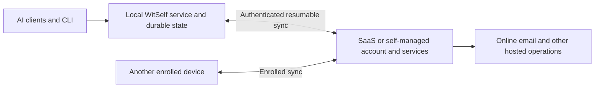

# Local-first WitSelf and continuous cloud synchronization

[WitSelf running locally research index](README.md)

Status: **local-cell direction selected and revisable; active design research.
No implementation approved by this document.** Started 2026-10-17. Source inspection baseline: `adc6f186`
(PR #755). This is a shared working document for Scott, Claude, and Codex.
Existing production behavior and the feature-status catalog remain authoritative.

Companion research: [local storage and competitor patterns](local-storage-and-sync-patterns.md)
connects the requested offline features to local storage/runtime alternatives and
current examples from agent-memory tools, note applications, and vault products.
The [code-backed assessment](local-mode-code-assessment.md) gives the requested
recommendation, infrastructure reuse analysis and effort breakdown.

## Direction from the discussion

Scott wants a simple personal/local WitSelf offering that is free and operates
almost entirely on the user's computer. Disclosed, best-effort usage reporting is required, while reporting failure must
never interrupt local use. Minimize local dependencies and avoid Kubernetes or
containers if possible; users should not administer the runtime or database.

The paid offering would supply hosted storage and services, with **continuous
synchronization built into the system**. A prepared local installation should
keep core operations usable during a WitSelf service outage and reconcile when
connectivity returns. The same product should make moving between local use and
paid hosted use straightforward.

Scott has now selected the local-cell direction, while explicitly inviting
adversarial review and evidence-backed revision. This supersedes the earlier
request to leave every direction open. Packaging, native lifecycle and sync
implementation remain undecided. The first design to evaluate reuses WitSelf
and PostgreSQL; a full Kubernetes stack is not implied. An embedded alternative
can still challenge the decision if it meets the same requirements more simply.

| Topic | Recorded direction | Status |
|---|---|---|
| Free personal offering | Standalone local cell; ordinary operations continue without service connectivity, including when reporting fails | Usage reporting is required; registration, reporting identity and controls remain to define |
| Paid offering | Hosted services plus continuous local/cloud synchronization | Synchronization is a required capability; implementation remains open |
| Synchronization scope | Whole account by default, with necessary account/feature exceptions investigated | Working scope from the discussion; no final design |
| Supported desktop platforms | macOS, Windows, and Linux in the first supported local release | Requested scope to investigate |
| Local data larger than destination | Explain the mismatch and preserve local data; never silently trim to fit | Scott raised and agreed to this safeguard |
| Local feature priorities | Transcripts and memories; secrets are a desired possibility, with more features to discuss | Scott's follow-up requirements; precise operation coverage remains open |
| Runtime experience | Minimize local dependencies; avoid mandatory Kubernetes and containers if possible | Native application plus managed PostgreSQL is the first packaging baseline to evaluate |
| Database parity | Reuse hosted search and transactional behavior when evaluating the local cell | Earlier parity concern was not an engine preference; final packaging and version policy remain open |
| Local cell | Reuse the application and database as a locally managed unit | Selected direction; does not require reproducing cloud topology |
| Integrated installation scenario | Installing WitSelf also deploys its isolated local cell; no separate user deployment step | Scott clarified this behavior within the local-cell scenario; no engine/stack selection |
| Operating modes | Standalone local/free offering plus required lightweight remote-service-only mode for containers, remote runtimes and autonomous agents | Local is the intended normal experience; making it the installation default can follow later |
| Ordinary local operations | Local searches, reads/writes, transcript access and client-driven memory reconciliation, with sync carrying changes remotely | Target behavior; enumerate authority/coordination exceptions rather than promise 100 percent local execution |
| Update ownership | The selected installation path should update the whole local cell, including compatible application/database state | Open lifecycle design; Homebrew on macOS is the discussion example |
| Synchronization timing/destination | Required continuous sync to SaaS or a self-managed remote cell; sequencing may be staged | Sync cannot be omitted from the target; protocol and schedule are undecided |
| Guided one-time transfer | An alternative/fallback to compare, not the selected main direction | Earlier suggestion superseded by the continuous-sync discussion |
| Replace today's free SaaS tier | Potential product packaging; existing-user transition still needs a decision | No catalog, billing, signup, or account-policy change authorized |
| Database, sync protocol, conflict rules, delivery schedule | Still open | Do not treat a candidate design as accepted architecture |
| Current decision | Local cell is the chosen direction, subject to adversarial challenge and revision | Packaging and sync remain design work; no implementation or effort estimate approved |
| Usage reporting | Disclosed best-effort utilization, usage and defined modification statistics | Never blocks local operation; payload, identity and controls require design |
| Feature discovery | Show relevant hosted capabilities and availability in the console/TUI | Quiet contextual explanations; no banners, nagging or interruption |
| Future opportunities | Native bare-metal/self-managed cells and later decentralized personal cells | Research opportunities, not first-release scope or implemented support |
| Development and rollout | Deploy inactive components and opt-in canaries while preserving current functionality, then evolve to supported completion | Fast iteration with explicit readiness and recovery gates; no immediate implementation/deployment authorized here |
| Backup destination alternatives | Consider alternatives separately from the main local-cell/sync work | Secondary research opportunity; basic upgrade/recovery safety remains necessary |
| Remote service authority | Hosted email, cross-machine messaging and control-plane-managed operations are authoritative at the designated remote service | Local replicas supply read/search views; copied records must not authorize delivery or shared work claims |

“Free local” concerns WitSelf hosting. An independently chosen AI application or
model can still have a cost and can still send its prompts/context to its own
provider. A local WitSelf data store does not make a cloud AI client offline.

## Proposed user experience

The product direction now includes two explicit operating modes with the same
CLI, MCP tools and AI-client integrations where supported. The local/free mode
installs its cell as part of software installation. It is the intended normal
local experience, but Scott clarified it need not be the default in the first
rollout. A lightweight remote-only
mode installs no local cell and talks to a selected service; it serves container,
cluster, remote and autonomous-agent use cases. No silent local-to-remote fallback
is implied: account identity, destination and read/write authority must remain
clear. Exact installation flags/profile selection remain open.

- **Personal/local:** capture, find, and manage supported state on this computer.
  Ordinary core use should not depend on a live WitSelf account directory or a
  recurring license/entitlement check. Required usage reporting has an explicit
  purpose and privacy/resource budget and never gates local functionality.
- **Paid/connected:** use local state while synchronized with the hosted account
  and other enrolled devices. Show whether changes are local-only, awaiting sync,
  synchronized, blocked by capacity, or awaiting conflict resolution.
- **Lightweight remote-only:** use a SaaS or self-managed service directly,
  without a replicated local account. This mode depends on that service's
  availability; it does not inherit the local mode's offline guarantee.
- **Service outage:** continue the declared offline-capable operations against
  already available local state; retain new work durably and synchronize later.
  Clearly distinguish queued work from a completed external action.
- **Return to personal use:** preserve access to local state. Subscription,
  hosted retention, remote credentials, and account closure require explicit
  product rules; disconnecting sync must not imply cancellation or deletion.

The free offering should support standalone local data operations without a
live control-plane dependency. Required synchronization is used when connecting
to a remote account; it is separate from required best-effort usage reporting.
“Local” does not mean no outbound traffic. Registration and telemetry identity
remain to define. A separate AI client may use an external model provider.
Hosted email and cross-machine messaging remain connected-service features.

See the [reporting and quiet feature-discovery contract](local-mode-code-assessment.md#usage-reporting-and-quiet-feature-discovery).
The product should report aggregate usage without content collection or blocking
on network failure. Console/TUI labels should distinguish a paid feature from
one that is offline, unconfigured or unsupported; exact self-managed entitlement
rules remain open.

In local mode, ordinary searches, reads/writes and transcript access should
be served by the local cell. An active AI client should be able to curate or
reconcile local memories against local state; that inference remains in the AI
client. Reconciling competing replica changes is a distinct synchronization
problem. Shared leases/claims, account authority and external effects may need
online coordination; the user explicitly acknowledged exceptions. Local write
durability, remote acknowledgement and account-wide convergence must be visible
as different states. Remote-only writers and other local devices can introduce
concurrent changes even while this device's reads are local.

Reduced hosted query traffic is a motivation, not a measured cost result.
Compare avoided reads/search work with sync ingestion, validation, conflict work,
fan-out, retained replica history, storage and network traffic. Initial full
copies and remote-only workloads remain cloud costs. The source/backend still
does no AI inference; local operation does not move a cloud AI provider offline.

This is **offline-first availability**, which can help during a service outage.
It does not replace independent backups or disaster recovery. Synchronization
can propagate mistakes and deletions; losing a disk can destroy an unsynchronized
local copy. A device cannot use records it never downloaded or decrypt a vault
whose key it does not possess.

The following is a conceptual target, not existing implementation:

The diagram leaves transport and packaging open. Remote authority for hosted
email and cross-machine messaging is required; whole-account replication does
not authorize every device to execute every operation.

## What the current repository actually provides

This section records source observations, not acceptance testing of a local
product. No application or database was run for this research.

| Observation | Evidence | Implication |
|---|---|---|
| Native server binaries already build for macOS and Linux; CLI also builds for Windows | [release configuration](../../../.goreleaser.yaml#L10), [server build](../../../.goreleaser.yaml#L32) | Native packaging is credible; Windows server distribution is an actual gap. The current CLI also excludes Windows ARM64. |
| `internal/local` stores named account/credential bindings, not canonical product data | [local package](../../../internal/local/local.go#L1) | Its name does not establish a local backend. |
| Named accounts normally resolve the hosted directory; explicit endpoints bypass that lookup | [operator resolution](../../../cmd/witself/main.go#L314), [agent resolution](../../../cmd/witself/main.go#L363) | A durable local/connected profile and offline resolver are needed. |
| MCP uses the authenticated API and verifies installed identity | [MCP connection](../../../cmd/witself/mcp.go#L138) | A private local service could reuse the API surface; retargeting must retain identity checks. |
| The store is concretely PostgreSQL-backed and startup runs migrations | [store](../../../internal/store/store.go#L16), [server startup](../../../cmd/witself-server/main.go#L181), [migrations](../../../internal/store/migrate.go#L61) | SQLite would require a storage/semantics port, not a connection-string change. |
| PostgreSQL-specific search and locking are used | [text search](../../../internal/store/migrations/0029_add_narrative_memories.sql#L120), [secret lock](../../../internal/store/secret_mutation.go#L656), [request reconciliation lock](../../../internal/store/message_request.go#L1238) | Preserve recall behavior, atomicity, idempotency, and concurrency semantics when comparing stores. |
| Whole-account customer export exists; customer import does not | [export CLI](../../../cmd/witself/export.go#L31), [import contract](../../api-routes.md#L2043), [archive importer](../../../internal/store/import.go#L6412) | Archives help bootstrap/recovery but do not provide continuous sync or a customer restore flow. |
| Existing moves assume one home and fenced evacuation | [cell move contract](../../deployment-cells.md#L851), [portability](../../backup-and-recovery.md#L1474) | Continuous writable replicas are a new architectural contract. |
| Vault ciphertext binds stable identities, while private keys stay with clients | [associated data](../../../internal/sealed/aad.go#L34), [vault custody](../../decisions/0003-client-custodied-agent-vault.md) | Preserve identity continuity; copying data does not install keys or authorize a device. |
| Existing plan-fit code compares account usage against a target plan | [plan fit](../../../internal/store/plan_fit.go#L33) | Reuse the concepts for capacity preflight; current code is not a local-sync admission protocol. |

Older documents describe `setup --local` or a serialized mock/local adapter
([self-hosting](../../self-hosting.md#L455), [API contract](../../api-contract.md#L448)).
The inspected [current command dispatcher](../../../cmd/witself/main.go#L126) has no
`setup` or local-mode command, and targeted source inspection found no such
persistence adapter. Treat that language as unverified historical/design text.
Do not market an existing local mode on that basis. Reconcile those documents
when an implementation direction is accepted.

## Local runtime options: a separate choice from synchronization

| Candidate | Advantage | Work/risk to investigate |
|---|---|---|
| Packaged native WitSelf service plus privately managed PostgreSQL | Reuses the most current domain behavior, schemas, search, and transactional guarantees | Cross-platform database distribution, Windows server support, size, idle resources, process ownership, sleep/restart, upgrades, backup, and uninstall |
| Replicate the deployed cell stack locally | Potential reuse of deployment configuration and component interactions as well as application behavior | Define which components belong locally; container/cluster footprint, networking, credentials, upgrades and cloud-external services need explicit treatment |
| Embedded SQLite behind shared domain contracts | Potentially smaller installation and simpler database lifecycle | Substantial PostgreSQL SQL/search/locking port; parity tests and multi-client concurrency; avoid creating divergent local/cloud business rules |
| Expose today's development/self-host setup | Useful engineering baseline | Does not meet the requested consumer experience |
| Harden the documented mock adapter | No demonstrated advantage yet | No current implementation located; cannot budget it as an existing shortcut |

SQLite supports device-local application storage and serializes writers; its
suitability here needs workload evidence, not an assumption that all concurrency
is impossible. See [SQLite's guidance](https://www.sqlite.org/whentouse.html).
Native PostgreSQL remains a managed server process even when packaged invisibly;
see [PostgreSQL's server documentation](https://www.postgresql.org/docs/18/app-postgres.html).

The local-cell direction is selected but revisable. The earlier SQLite suggestion
and PostgreSQL-parity discussion remain useful comparison history, not decisions
that override the later selection. Compare native packaging with managed
containers only where they add concrete value; requiring Kubernetes is something
to avoid if possible. Standard PostgreSQL remains a separate process, even with
no container. A fully embedded or in-process engine would reopen storage design.

Neither the same database engine nor the same stack supplies bidirectional
account synchronization. Equivalent retrieval depends on data, schema, search
configuration and application versions; identical speed or relevance is unproven.
The [adversarial review criteria](local-mode-code-assessment.md#adversarial-review-and-grounds-to-revise-the-decision)
explain when to revisit the chosen direction.

All candidates need private local transport, authentication, owner-scoped files,
one lifecycle owner, crash recovery, schema upgrades, bounded disk use, and a
restore procedure. Existing server defaults include API/health/metrics listeners
([listener setup](../../../internal/server/server.go#L2322)); a local product must
explicitly enforce private access rather than inherit all-interface defaults.
The user should not have to administer Docker or Kubernetes. Whether the product
contains any automatically managed container/cluster machinery is now an open
tradeoff under the local-cell option, not a settled packaging requirement.

## Continuous synchronization: the main design work

Scott raised sequencing local cell installation before synchronization, then
explicitly clarified that synchronization itself is required. Any staging can
separate implementation milestones but cannot omit sync from the target. Before
choosing such staging, identify which stable identities, deletion records and
version contracts must exist early to avoid stranding local data later. Do not
claim hosted outage continuity or seamless joining of existing accounts before
replication exists. A future destination might be SaaS or a self-managed remote
cell; protocol support, enrollment and compatibility must be established for
either. See the [installation and update discussion](local-storage-and-sync-patterns.md#installation-updates-and-sync-delivery).

The existing cloud store has one database authority for sequences, versions,
claims, and account policy. Two independently writable copies require explicit
rules. Database copying or periodically importing an archive cannot establish
those rules.

A candidate protocol needs stable account/realm/agent identity; enrolled device
identity; durable operation IDs and an outbound journal; base versions or causal
metadata; resumable download cursors; duplicate-safe receipts; and compatibility
negotiation. Local acceptance, cloud acceptance, and convergence must be separate
states. A lost acknowledgement must not create duplicate records or effects.

| Data/operation family | Candidate offline behavior to research | Required reconciliation rule / limitation |
|---|---|---|
| Existing facts/memories and recall | Read locally available state | Indicate freshness and authorization horizon; recover missing data after reconnect |
| New independent facts/memories | Persist locally and queue replication | Deduplicate creation; preserve origin and evidence; do not silently overwrite another assertion |
| Changes to the same fact/memory | Allow only under defined conflict semantics | Preserve competing versions and provenance; choose explicit conflict handling rather than a blanket last-write-wins rule |
| Transcripts and memory evidence | Capture locally with stable entry identity and origin order | Current integer sequences are assigned under a database row lock; disconnected allocation must not collide or invalidate evidence ranges |
| Permanent deletion | Record an authoritative deletion operation/tombstone for later propagation | Prevent stale replay from resurrecting data; define acknowledgements, offline-device expiry/rebootstrap, and explicit new recreation |
| Vault records and TOTP | Cached ciphertext plus matching client keys can support declared local access | Key enrollment/rotation, retired epochs, grants, and revocation need coordinated rules; never sync AVK plaintext to the backend |
| Same-machine messages/coordination | Could operate through the local service | Distinguish local work from shared work; server-issued claims cannot simply be recreated on every disconnected replica |
| Cross-machine/autonomous-agent messaging | Read/search synchronized message history locally; retain offline outgoing intent as pending | Remote mailbox/request graph owns delivery, claims, acknowledgements and shared work authority; local replicas cannot execute copied fences |
| Shared claims and curation plans | Potentially defer shared authority while disconnected | Existing leases/fences depend on one authority; prevent two clients completing the same work with conflicting authority |
| Email, billing, account administration | Display known state; queue only operations explicitly designed for it | Receiving/sending real email and external effects need online services, idempotency and receipts; queued does not mean sent |
| Avatars and other ordinary versioned content | Cache/read locally; evaluate versioned mutation support | Preserve lifecycle revisions, policy, identity, and conflicts |

Relevant seams: [transcript sequence allocation](../../../internal/store/transcript.go#L236),
[memory expected versions](../../../internal/store/memory.go#L847),
[memory change clock](../../../internal/store/memory.go#L1358),
[fact recreation](../../../internal/store/fact.go#L270),
[memory deletion](../../../internal/store/memory_delete.go#L79),
[message fencing](../../../internal/store/message.go#L504), and
[vault rotation](../../../internal/store/vault_key_rotation_mutation.go#L493).
These establish constraints, not an existing synchronization implementation.

Scott explicitly requires remote authority for hosted email and cross-machine
messaging. Remote ingestion, delivery/admission and shared claim/acknowledgement
state are canonical at the designated service; authorized views synchronize to
local cells. Do not run a local dispatcher or treat copied leases as authority.
Any offline outgoing intent needs remote validation before it is called sent,
delivered or claimed. This does not force ordinary memory/transcript writes to
require connectivity. A separate same-machine-only messaging facility, if pursued,
must not masquerade as the shared remote mailbox.

Whole-account sync is the default **scope**, not an upload grant for every local
row. The cloud must independently authenticate ownership and assign paid
entitlements, provider routes, and other hosted authority. A modified local
database must not be able to grant a paid plan or resurrect revoked access.
Define how local work is retained when an upload is refused. Offline revocation
cannot be instantaneous on an unreachable computer; the product needs a stated
offline-access policy rather than an implicit promise.

## Capacity mismatch: a local account can outgrow its destination

Scott specifically raised this case. Whole-account defaults must not quietly
become partial synchronization or destructive trimming when the cloud plan is
smaller than local state.

Proposed acceptance behavior:

1. Before first cloud synchronization, compare a coherent inventory with the
   actual destination's storage/count/feature limits. Use value-free summaries.
2. If it does not fit, explain the limiting dimensions and leave local state
   usable and unchanged. Offer a fitting plan or a user-reviewed data-management
   action; do not automatically delete or omit content.
3. Reserve/recheck admission during upload; a stale preflight is not sufficient.
   Repeated retries must not double-charge capacity or publish a misleading
   “synchronized” state.
4. Specify what happens if local data grows past the paid limit while offline:
   preserve new local work and show synchronization blocked, with a recovery
   path. Whether safe independent changes can proceed needs protocol design.
5. Apply corresponding checks when a cloud account is too large for a device.
   Whole-account scope does not prove every device has enough disk for a usable
   full replica. Do not advertise outage readiness until required state is local.
6. Define downgrade, cancelled-subscription, retention, and expired-device
   behavior explicitly. Account closure/deletion is separate from selecting
   local mode or stopping payment.

Existing [plan-fit reporting and atomic fit/apply](../../../internal/store/plan_fit.go#L103)
are useful starting concepts. Current managed authority must not be copied from
an untrusted local archive. No pricing, plan limits, or free-tier migration has
been changed by this research.

## Identity, enrollment, and portability

Use one logical account identity across local and hosted modes where the eventual
ownership protocol permits it. Vault associated data binds immutable account,
realm, agent, secret, and field IDs, while excluding host/cell coordinates.
Creating a different cloud account and remapping all rows is not a simple
encrypted-vault migration.

Design safe adoption of local identities into SaaS, collision handling, account
ownership proof, enrolled-device credentials, token rotation, and atomic changes
to installed integration bindings. AVKs require separate client-held transfer,
enrollment, or recovery. Full account data must never be confused with vault-key
backup. Device enrollment must retain per-agent permissions even if the account
is the synchronization unit; whole-account sync does not authorize every agent
to read every other agent's data.

Device enrollment also needs a distinct trust boundary. An agent credential must
not automatically authorize downloading the whole account. An owner-authorized
personal device and an agent-scoped/shared device may need different enrollment
rules. API permission checks cannot prevent the local operating-system owner or
a compromised local service from reading downloaded open-plane database files.
Specify local at-rest protection and who is trusted with the complete replica;
revocation cannot remotely erase an unreachable device's existing copy. The
client-held vault-key boundary remains separate from open-plane disk protection.

Archives may seed an initial replica or restore a snapshot, followed by a
well-defined change-log catch-up. Existing self-export is a consistent snapshot,
not a write freeze; existing import rejects an ordinary existing destination and
resets active claims. It therefore cannot be reused unchanged for incremental
sync or overwrite on return. See [export](../../../internal/store/export.go#L159),
[import](../../../internal/store/import.go#L6674), and
[import lifecycle behavior](../../backup-and-recovery.md#L521).

Historical email records may travel as account data; that does not move public
DNS, sender identity, inbound provider routing, or billing relationships. A
strict local-only instance also cannot receive calls from another computer.
Same-machine agent collaboration, cross-device synchronization, and future
cross-realm federation are different features.

## Research slices and collaboration with Claude

Scott expects incremental deployment and continued evolution to completion.
The [development and canary plan](local-mode-code-assessment.md#incremental-development-and-deployment)
separates shipping inactive code from cell installation, local routing, sync
enrollment and a later default change. Preserve existing operations throughout.
The slices below are research/design inputs to that delivery plan, not assigned
implementation tasks or deadlines. Establish evidence before an end-to-end ETA.

1. **Offline behavior contract.** Fill in the operation matrix above: allowed
   reads/writes, authority, conflicts, retention, and reconnect behavior. Whole
   account and all three desktop platforms are the recorded starting scope.
2. **Desktop runtime comparison.** Measure install size, cold start, idle RAM,
   restart durability, multiple local AI clients, disk growth and upgrade/restore
   on macOS/Windows/Linux. Compare native PostgreSQL reuse with an embedded port.
3. **Small synchronization proof.** Use synthetic accounts/devices and a local
   simulated service. Prove durable captures, disconnect/reconnect, stable
   evidence identity, duplicate delivery, and resumable acknowledgement before
   broadening operation coverage. This would demonstrate protocol properties,
   not declare whole-account production synchronization complete.
4. **Account identity and admission.** Design safe SaaS adoption/enrollment,
   authenticated authority, oversized accounts, incremental growth, downgrade,
   and device storage admission.
5. **Conflict and recovery proof.** Exercise two offline writers, deletion versus
   stale upload, schema skew, partial resync, revoked devices, key rotation,
   lost acknowledgements, full disk, crashes, and restoration from backup.
6. **Hosted-dependent features and product transition.** Specify email/shared
   work behavior during outages; decide how an existing free hosted account
   transitions without forced data loss or implied subscription changes.

Claude can challenge the storage comparison, locate any missed local prototype,
review the operation/authority matrix, and map incremental interfaces. Record
findings here with source references and distinguish inspected code, proposals,
executed experiments, and unresolved questions. Do not treat historical local
mock documentation or shared PostgreSQL schemas as proof of offline sync.

## Open questions for the next discussion

- What reporting fields, modification indicators, identifiers, retention and
  user controls meet the required disclosed, nonblocking usage-reporting contract?
  Is registration needed, and how does setup remain usable without connectivity?
- Which core mutations must work during an outage in the first supported paid
  release, and which operations can clearly wait for reconnection?
- How should conflicting fact/memory edits be presented and resolved, and who
  may make that decision? Which changes can be merged deterministically?
- Does every enrolled paid device require the complete history locally, or is
  an explicitly described availability window acceptable? Account sync scope
  and local storage capacity are distinct decisions.
- What is the permitted offline-device lifetime, including revoked credentials,
  deletion propagation, resnapshot, and recovery after a long absence?
- Who may enroll a device with the complete account replica, and what protection
  is required for open-plane data on personal versus shared computers?
- How are existing free SaaS users treated if the proposed packaging replaces
  that tier? No removal, forced migration, or grace period has been decided.
- What performance, footprint, restore, and platform acceptance thresholds
  define “simple enough” before selecting a runtime?

## Evidence and change log

- 2026-10-17: read-only code/document audit at `adc6f186`; reviewed runtime,
  capabilities, export/import, vault identity, plan-fit and concurrency seams.
  No application tests, local database experiment, production writes, or sync
  benchmark were performed. External database documentation was consulted only
  for general runtime/concurrency tradeoffs; no third-party sync vendor chosen.
- 2026-10-17: Scott clarified continuous sync and outage continuity as the main
  direction, mostly-local free versus hosted paid packaging, whole-account sync
  by default, all three desktop platforms, and preserving local data on a
  destination-capacity mismatch. Architecture and implementation remain open.
- 2026-10-17: Scott prioritized local transcripts/memories, potentially secrets,
  and technology suited to native local execution. Added the linked storage and
  competitor comparison; SQLite was an assistant suggestion, not an accepted
  implementation decision. Current vendor documentation was read;
  no competitor was installed or benchmarked.
- 2026-10-17: Scott clarified that PostgreSQL equivalence is a discussion point,
  not even a leaning or preference, and requested pros/cons without decisions.
  He also raised reproducing the entire cell locally as an option to explore.
  Removed the leading-engine recommendation; scope, packaging and engine remain
  open. Retrieval relevance and behavioral parity need evaluation alongside speed.
- 2026-10-17: explored an isolated local cell deployed as part of software
  installation, with whole-cell update ownership and possibly deferred sync to
  SaaS or self-managed remote cells. Scott clarified there should be no separate
  cell-deployment step in that scenario. No packaging or sequencing choice made.
- 2026-10-17: Scott requested a local-by-default mode with ordinary data
  operations and client-driven memory reconciliation served locally, plus an
  explicit remote-only lightweight client option. Added synchronization authority
  exceptions and the hosted-load hypothesis; no measured savings or 100 percent
  local-operation guarantee claimed.
- 2026-10-17: clarified required synchronization and lightweight remote-only
  installation, later expressed a local-cell leaning, and requested a thorough
  code-backed recommendation including infrastructure tooling. Hosted email and
  cross-machine messaging must retain remote authority. The free offering is a
  standalone local cell; making it the installation default may come after the
  first rollout. These requirements do not select a database/packaging technology.

- 2026-10-17: Scott selected the local-cell direction and explicitly requested
  adversarial review and revisability. Minimal dependencies, preferably no
  Kubernetes or containers, are the local design target. Added required disclosed
  nonblocking usage reporting, understated hosted-feature discovery, native
  bare-metal reuse and future decentralized cells as research opportunities.
- 2026-10-17: added Scott's requirement for rapid incremental development,
  inactive deployment and opt-in canaries on his or enrolled test machines,
  preserving current functionality until each new capability is ready. Delivery
  must evolve to a complete supported product; default switching remains separate.
