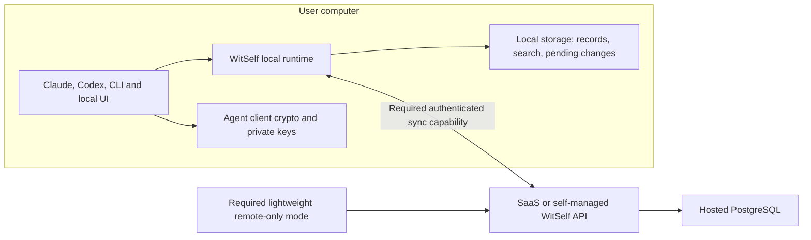

# Local storage, offline features, and patterns worth borrowing

[WitSelf running locally research index](README.md)

Status: **local-cell direction selected and revisable; packaging and sync open.** Updated
2026-10-17. Companion to [the active local-first discussion](local-first-mode.md).
WitSelf source baseline is `adc6f186`; external claims below describe primary
documentation accessed on 2026-10-17. No competitor installation, performance
benchmark, storage prototype, or production change was performed.

## Discussion frame and revisable local-cell direction

Scott selected the local-cell direction after considering embedded storage,
native PostgreSQL and reproducing the deployed stack. He explicitly invites
adversarial review and later revision. Minimize local dependencies and avoid
mandatory Kubernetes or containers if possible. This favors investigating native
WitSelf processes and managed PostgreSQL first, without deciding final packaging.
See the [code-backed assessment](local-mode-code-assessment.md) for the rationale,
infrastructure reuse, installer paths and grounds to change direction.

The earlier PostgreSQL-parity concern was a consideration, not a preference;
the subsequent local-cell selection is a separate explicit decision. Retain the
alternatives below as evidence for challenge, not as equally selected designs.
Required synchronization and the lightweight remote-only installation remain
part of the product contract. Standard PostgreSQL still runs as a separate
process: container-free is not the same as an embedded database.

No proprietary storage engine has a demonstrated need. Existing hosted
PostgreSQL supplies a behavioral comparison baseline, not proof of identical
local performance or a completed consumer installation.

“Same data format” has three meanings that should be decided separately:

1. **Logical data model:** keep consistent account/realm/agent identities,
   transcripts, memories, facts, versions, evidence, deletion state and encrypted
   vault envelopes across modes. This should remain shared.
2. **Physical database layout:** SQLite files and PostgreSQL storage need not be
   interchangeable or have identical indexes/SQL. Separate storage adapters must
   pass common behavioral tests. The current concrete PostgreSQL store does not
   already provide that interchangeable boundary.
3. **Transfer protocol:** synchronize validated domain operations and records
   with stable identifiers, receipts and conflict rules. Do not synchronize a live
   database file or assume database replication supplies account semantics.

WitSelf will still have its own schema and protocol. Those should be documented,
versioned application contracts on top of a proven engine, with portable export.

## How the requested local features shape storage

The target capabilities below are proposals; none is a claim that a supported
local-only WitSelf product already exists.

| Feature | Useful local behavior | Storage/design requirement |
|---|---|---|
| Transcripts — requested | Durable capture, browsing and search while the service is unavailable | Ordered entries with stable identity, efficient appends, indexes, retention, evidence references and bounded disk growth |
| Memories — requested | Capture, recall, edit history and provenance locally | Structured versions, links/evidence, lexical search, transactions and concurrent-update checks |
| Facts — candidate core companion | Store/query typed assertions and subjects | Address uniqueness, provenance, conflicts and deletion/recreation rules |
| Secrets/TOTP — possible requested scope | Create/use protected local records and generate codes using installed keys | Existing client encryption, separate key custody, encrypted fields excluded from search/logs; recovery and key-epoch policy |
| Curation — candidate | An active AI client can review local inputs and apply authorized changes | Local fenced operations and policy; paid shared work needs its own authority rules |
| Same-machine messaging — candidate | Multiple agents on one computer communicate | Atomic mailbox writes, identity checks and claims; distinguish shared cloud jobs |
| Avatars/settings — candidate | Read/update allowed versioned state | Consistent lifecycle and synchronization rules |
| Email and other external effects | Known history may be available locally | Live receipt/delivery, billing and cross-device coordination still need their online services |

These features need more than a bag of text files, but none requires a remote
database merely because it stores a transcript or memory. Search indexes can be
derived from canonical local records. Keyword search can work without a model;
optional semantic embeddings and AI-authored memories depend on the selected
client/model runtime. A WitSelf outage and a complete internet outage are
different cases for someone using cloud AI.

Secrets do not require a second proprietary database. The local store can retain
the existing ciphertext packages and public metadata while authorized agent
clients retain the keys. Database encryption, host/disk protection and vault
field encryption are distinct decisions. Do not index plaintext secret values
or send AVKs through synchronization. Current
[secretclient](../../../internal/secretclient/secretclient.go#L1) still performs
authenticated backend calls, so possession of an AVK alone does not make today's
client a fully offline vault.

## Logical architecture to discuss

This diagram describes the selected local-cell direction while leaving packaging
and synchronization implementation open. The native PostgreSQL baseline is a
recommendation to test, not a claim of implemented local support.

The local runtime owns domain validation and storage access. It may use a small
automatically managed background process to coordinate multiple AI clients;
that does not require containers. Standard PostgreSQL remains a separate
database process in the native-cell baseline. Evaluate private sockets/named
pipes or a secured loopback API against integration portability. Fully embedded
storage is a counterproposal requiring reconsideration of the storage design;
it must preserve common authorization and concurrency rules.

For every storage design, record mutations and pending-sync entries should commit
atomically. A crash must not leave an acknowledged record that can never sync,
or a queued mutation whose local record was lost. Remote connectivity adds upload,
download and reconciliation; the local core should not need the cloud just to
open its database. Exact offline authority rules remain in the main research
document.

In local mode, clients should search/read/write the local cell,
including transcripts and client-driven memory curation. The remote-only client
is an explicit alternative with no local cell or offline replica. Its writes
must participate in the same future synchronization protocol as other writers.
Local memory reconciliation by an AI client and synchronization conflict
reconciliation are distinct; existing cloud leases cannot simply be duplicated
on disconnected cells. Enumerate operations requiring shared authority or
external services. Reduced hosted search/read traffic is plausible, but net
infrastructure savings require measurement of sync, storage and fan-out costs.

## What could “the entire cell locally” mean?

The local-cell direction is selected; which components ship remains open. The
cell boundary and the synchronization boundary are separate questions. Native
packaging with minimal dependencies is the first baseline to evaluate.

| Option | Potential benefit | Cost or unresolved question |
|---|---|---|
| Application/database equivalent | Existing WitSelf API, PostgreSQL, configuration/authentication and appropriate worker jobs reuse current domain behavior | Manage native processes, upgrades, recovery and private access; establish platform support and decide which jobs belong locally |
| Full deployment stack | Add the cell's Kubernetes/Argo/Helm topology and configured controllers/networking/monitoring; reuse operational configuration | More dependencies and persistent-volume/network lifecycle; adapt cloud provisioning, sleep/restart and desktop resource use |
| Synchronized local data cell | Either packaging can hold local account state and reconnect to the hosted account | Safe two-way writes still need identity, conflicts, deletion, authority, capacity and lease rules; database/stack similarity does not supply them |

Source boundaries at the inspected revision:

- [Application startup](../../../cmd/witself-server/main.go#L181) opens PostgreSQL
  and migrates it independently of Kubernetes packaging.
- The [cell worker](../../../cmd/witself-worker/main.go#L1) is separate from the API.
  Its jobs include retention, account purge and email dispatch; copying hosted
  worker configuration would not establish appropriate offline authority or
  prevent duplicate external effects.
- [Database/backup chart configuration](../../../.gitops/charts/apps/values.yaml#L30)
  includes persistent storage and optional remote backup/secret integration.
- [GitOps structure](../../../.gitops/README.md#L9) separates bootstrap, platform and
  application components; DNS, TLS, ingress and cloud IAM also have ownership
  outside the application database. Platform components vary by configuration.
- [External workload destinations](../../deployment-cells.md#L164) include the
  email edge and remote backup storage. Hosted routing/control-plane authority,
  billing, public email and remote object services are not supplied simply by
  placing a cell on a laptop.

Discussion question: which similarities are worth their footprint—same database
semantics, same application processes, same containers, or the full orchestration
stack? Reproducing behavior and reproducing topology should each have explicit
pros, cons and acceptance measures. Containers or Kubernetes would need to
justify their dependencies against the native baseline.

## Installation, updates and sync delivery

Installing the local WitSelf offering must deploy its isolated cell as part of
the same operation, without separate user-run provisioning. This is essentially
the free product; making it the initial installation default can follow later.
An explicit remote-only installation must remain lightweight and deploy no cell.
Existing remote users must not silently acquire a new account home or destination
through an ordinary software update.

Continuous synchronization with SaaS or a self-managed remote cell is required
for connected use; delivery may be staged, but sync is not optional target scope.
Standalone local use need not enroll a remote account. Disclosed best-effort
usage reporting is a separate requirement and cannot block local operation.
Startup at login, boot or on demand remains a lifecycle decision.

The [infrastructure and native-install assessment](local-mode-code-assessment.md#native-installation-and-updates)
compares Homebrew/shell installation, Windows installers/WinGet and Linux package
paths, including one shared cell lifecycle and a possible infra CLI frontend.

Current implementation is narrower: the [Homebrew product list](../../../tools/homebrew-formula/main.go#L40)
and [formula template](../../../packaging/homebrew/formula.rb.tmpl#L14) install
binaries/aliases, with no local-cell service definition. The
[Unix installer transaction](../../../install.sh#L611) protects binary replacement,
not a database migration. Existing [schema migration guards](../../../internal/store/migrate.go#L37)
are reusable but do not upgrade the PostgreSQL engine itself.

| Topic | Benefit or intended behavior | Tradeoff/question to resolve |
|---|---|---|
| Local cell included in installation | Users install WitSelf and receive a ready local environment | Setup time/size, platform dependencies, failure recovery and an explicit successful-readiness check |
| Cell is the normal local runtime | Clients share durable state without manual server administration | Idle CPU/RAM, battery, service ownership, stopping, multiple OS users and private access |
| Required sync delivered in stages | Local value and replica semantics can be evaluated in separate milestones | Sync must be completed for the target product; no claim of SaaS outage continuity before it exists |
| Existing installation path owns updates | A Homebrew user has one supported upgrade path covering the cell | Define package delivery versus application/database migration, component compatibility and service restart; avoid competing updaters |
| SaaS or self-managed remote destination | Same local product could connect to different hosted arrangements | Authenticated enrollment, account identity, quotas, supported versions and endpoint capability discovery are still required |

Homebrew can install/upgrade packages and manage services through macOS launchd
or Linux systemd. Its service commands distinguish registration at login/boot
from a one-off run. A formula can declare service behavior. These mechanisms do
not themselves implement WitSelf's safe multi-component or data upgrade. Sources:
[Homebrew commands](https://docs.brew.sh/Manpage),
[service definitions](https://docs.brew.sh/Formula-Cookbook#service-files).

One ownership model to discuss is: the package manager delivers a verified
compatible release, and a WitSelf lifecycle component coordinates the local cell.
Another is package-managed components with explicit compatibility checks and
ordered service actions. Either should expose one supported user update path;
neither should assume “new executable installed” means “cell successfully
upgraded.” Automatic updating versus an explicit package upgrade is a separate
product choice. Equivalent ownership must be designed for Windows and other
Linux installation paths, not inferred from Homebrew support.

Candidate whole-cell update contract, subject to design:

1. Identify the managed installation and component/schema versions; verify the
   target release and supported upgrade route. Keep account data and private keys
   outside disposable package-version directories.
2. Check disk space and recovery readiness, coordinate active writers, and stage
   any replacement components before crossing an irreversible migration boundary.
3. Apply application schema and configuration changes in a controlled order.
   Treat a PostgreSQL major-version change separately from application migrations
   and routine database patch updates.
4. Restart the relevant services, verify database/schema compatibility and core
   read/write behavior, and report the installed versus healthy-running state.
   Interrupted updates should resume or recover predictably.
5. Define rollback boundaries. Reinstalling an older binary does not undo a data
   migration; restoring an older backup can lose later writes. Retain a deliberate
   recovery path and never silently discard local or unsynchronized work.

PostgreSQL documents distinct major-version migration paths, including dump/
restore and `pg_upgrade`; replacing its executable alone is not that procedure.
See [PostgreSQL upgrades](https://www.postgresql.org/docs/18/upgrading.html).
If the full cell includes a container runtime or local cluster, upgrades also
cover its persistent volumes, images and orchestration compatibility.

Staging synchronization need not mean deciding all its implementation now.
It does mean discussing the local record identities, evidence references, key
custody, deletion/version history and supported schema changes that later sync
must preserve. Joining two already-populated accounts and handling mixed-version
devices are explicit future problems, not consequences of both using PostgreSQL.

## Storage alternatives

| Candidate | Relevant strength | Cost or question to investigate |
|---|---|---|
| SQLite | Embedded transactions, relational constraints, mature file-backed storage and FTS5 text search | Requires porting PostgreSQL-specific semantics and testing contention/search/recovery |
| Packaged PostgreSQL | Immediate reuse of existing WitSelf SQL, search and transaction mechanisms | Still a database server with cross-platform lifecycle/distribution work; match versions/configuration and test parity |
| Full local cell stack — a packaging option | Reuse of deployed components and configuration, potentially reducing local/cloud divergence | Define the component boundary, resource use, networking, update ownership and external-service dependencies; not itself a new database engine or sync protocol |
| Embedded key/value engine such as bbolt | Native Go transactions and simple embedded persistence | Viable primitive, but WitSelf would own additional indexes, query/search integration and relationship enforcement |
| DuckDB | Embedded analytical queries over large datasets | Useful candidate for optional transcript analysis; transactional application state is not its primary optimization target |
| Markdown/JSONL with derived indexes | Inspectable user files and simple export | Good export/interchange or append-stream building blocks; preserving multi-record invariants would require much more application machinery |
| New proprietary storage engine | Complete control | No demonstrated need justifies assuming responsibility for storage integrity, locking, recovery and tooling |

SQLite runs inside its host process and requires no database server. FTS5
provides text search, and writes are serialized. Those properties suit the
proposed investigation; they do not establish measured suitability for WitSelf.
Sources: [SQLite execution model](https://www.sqlite.org/serverless.html),
[FTS5](https://www.sqlite.org/fts5.html),
[transaction isolation](https://www.sqlite.org/isolation.html).

bbolt is a transactional embedded key/value engine with a single writer and
multiple readers. DuckDB targets analytical workloads. The tradeoffs above are
inferences from WitSelf's operation mix, not a vendor benchmark or an engine ranking.
Sources: [bbolt](https://github.com/etcd-io/bbolt),
[DuckDB design goals](https://duckdb.org/why_duckdb).

Important SQLite acceptance work includes Go driver/build distribution on all
three OSes, busy/retry behavior, atomic outbox writes, schema migration, backup
and restore, large transcript workloads, and disk-full/crash recovery. Existing
[PostgreSQL recall](../../../internal/store/memory_recall.go#L252) uses PostgreSQL
text parsing/ranking: FTS5 does not automatically produce equivalent results.
Define required search semantics and conformance cases. Preserve stable evidence
identity and exact authorization independently of retrieval ranking.

Deletion also covers derived search data, journals and backup policy. FTS5's
documentation explains its own deletion/remanence behavior; selecting SQLite
does not by itself prove WitSelf's permanent-deletion contract. See
[FTS5 secure-delete](https://www.sqlite.org/fts5.html#the_secure_delete_configuration_option).
This research does not promise erasure from disconnected devices or old backups.

### Retrieval quality and PostgreSQL equivalence

Returning matching records quickly is only part of useful memory recall. The
comparison should ask whether realistic questions recover the relevant,
still-valid memories with provenance, and distinguish a superseded proposal
from a current decision. Word matching, ranking, structured filters, relationships
and optional meaning-based retrieval are separate design elements; changing a
storage engine neither solves nor necessarily prevents useful recall.

Using PostgreSQL on both sides can reuse today's queries, indexes and transaction
semantics, reducing one source of behavior differences. It does not automatically
give one-to-one results or timing: local/cloud data, application/schema versions,
text-search configuration, hardware and concurrent work still matter. A SQLite
comparison would additionally need deliberate search/SQL compatibility work.
Measure relevance and freshness as well as latency, with realistic questions and
account sizes, without assuming current hosted retrieval is already perfect.

## Competitor and adjacent-product observations

These are selected architecture patterns, not a complete competitive ranking.
The older [competitive analysis](../../competitive-analysis.md) remains historical;
do not carry its broad feature comparisons forward without checking them.

| Product | Verified published pattern | Idea worth borrowing / boundary |
|---|---|---|
| **Claude-Mem** — direct agent-memory example | SQLite/FTS5 canonical storage, local worker, optional semantic-search projection; paid two-way cloud sync is documented | Embedded local records plus retryable outbound work and inbound cursors. Its replicated memory objects are much narrower than WitSelf's account/permissions/vault model. |
| **Mem0 / OpenMemory** — direct memory comparison | OSS library and Docker server are distinct; Python-library defaults of local Qdrant plus SQLite history differ from the server's PostgreSQL/pgvector defaults | An embedded library is a legitimate architecture option, but local storage is not necessarily a single engine or offline inference. Reviewed migration docs do not establish continuous replica sync. |
| **Joplin** — adjacent local-first architecture | Clients use SQLite; typical server uses PostgreSQL metadata; domain items are synchronized | Strong example of different local/cloud engines behind shared models and a sync protocol. Note merge rules cannot be reused unchanged for facts or work claims. |
| **Obsidian** — adjacent product experience | Local Markdown vaults work independently; paid Sync connects local and remote vaults and catches up after offline work | Free local utility with paid hosted convenience; expose conflict status. File merging is not WitSelf account reconciliation. |
| **1Password** — adjacent sealed-data experience | Previously synchronized encrypted data remains usable offline | Cache availability, key enrollment and offline revocation limits must be explicit. Reviewed current sources do not identify a desktop database engine. |
| **Bitwarden** — adjacent counterexample | Current official offline mode is read-only; additions/edits are unavailable | “Offline access” alone does not meet the requested independent writable local product. |

### Direct memory-tool evidence

Claude-Mem documents local SQLite/FTS5 and a managed worker, not a process-free
library. Its paid synchronization uses an ordered log, origin deduplication,
pending uploads and pull cursors. Scope includes observations, summaries, prompts
and specified mutations. The documentation also limits older prelaunch records
and allows prompt truncation; those are **not** suitable precedents for silently
reducing WitSelf's whole-account data. Cloud-model extraction still depends on
its provider unless a local provider is deliberately configured. Published
installation guidance covers the three desktop OSes; none was tested here.
Sources: [database](https://docs.claude-mem.ai/architecture/database),
[cloud sync](https://docs.claude-mem.ai/cloud-sync),
[installation](https://docs.claude-mem.ai/installation),
[local model configuration](https://docs.claude-mem.ai/usage/openai-compatible-provider).

Mem0's current OSS overview separates an importable library from the server and
documents different storage defaults; the local Qdrant/SQLite description above
applies to its Python library. Default generation/embedding uses remote
models; its local cookbook uses Ollama and Qdrant. Current hosted OpenMemory/MCP
documentation must not be conflated with the historical Docker OpenMemory launch.
The OSS-to-Platform migration path switches to hosted service; it is not evidence
of continuous two-way offline operation.
Sources: [OSS overview](https://docs.mem0.ai/open-source/overview),
[local cookbook](https://github.com/mem0ai/mem0/blob/main/docs/cookbooks/companions/local-companion-ollama.mdx),
[current hosted MCP](https://docs.mem0.ai/platform/mem0-mcp),
[migration](https://docs.mem0.ai/migration/oss-to-platform).

### Local-first and vault-product evidence

Joplin separates shared application models, local SQLite, and the server's item
API. Its sync specification includes local pending state and blocked items,
including hosted-limit refusals. Its documented conflict handling preserves an
alternative when safe merging is unavailable. Encryption during synchronization
must not be confused with encrypting the local database.
Sources: [architecture](https://joplinapp.org/help/dev/spec/architecture/),
[sync](https://joplinapp.org/help/dev/spec/sync/),
[conflict specification](https://joplinapp.org/help/dev/spec/conflict_auto_merge/),
[encryption](https://joplinapp.org/help/dev/spec/e2ee/).

Obsidian offers a useful product analogy: usable local files plus a paid remote
vault. Its documented automatic merges and conflict copies demonstrate that
sync still needs visible recovery paths. Its security docs distinguish remote
end-to-end encryption from unencrypted local vault files. The server database
technology was not established by these sources.
Sources: [local storage](https://obsidian.md/help/Files%2Band%2Bfolders/How%2BObsidian%2Bstores%2Bdata),
[local/remote vaults](https://obsidian.md/help/Obsidian%2BSync/Local%2Band%2Bremote%2Bvaults),
[paid Sync](https://obsidian.md/sync),
[conflicts](https://obsidian.md/help/sync/troubleshoot),
[security](https://obsidian.md/help/sync/security).

1Password's current support confirms offline access to previously synced items
and that removing/suspending an account member cannot immediately remove access
on an offline device. A 2021 employee answer describes offline edits, but this
research does not use that older answer as a current all-platform guarantee.
Bitwarden explicitly documents read-only offline access. Neither behavior alone
establishes an independent local account or solves WitSelf's key-rotation rules.
Sources: [1Password sync](https://support.1password.com/sync/),
[offline revocation](https://support.1password.com/add-remove-team-members/),
[Bitwarden offline](https://bitwarden.com/help/using-bitwarden-offline/).

## Suggested next design work with Claude

The [incremental delivery proposal](local-mode-code-assessment.md#incremental-development-and-deployment)
keeps existing behavior intact while shipping inactive foundations and opt-in
canaries. Development should evolve through explicit readiness criteria to a
complete supported offering; a prototype alone is not the intended outcome.

1. Define the required local operations for transcripts, memories and facts;
   decide whether secrets ship initially and which vault lifecycle actions can
   wait for connectivity. Keep future features visible without promising them.
2. Map current application, database and cell boundaries. Compare what each
   option reuses and changes, including SQL, transactions, indexes, idempotency,
   evidence constraints and operational components.
3. Agree on questions and acceptance measures before choosing experiments:
   retrieval relevance, capture/search behavior, resource use, install/upgrade,
   crashes, contention and platform support. Native PostgreSQL, embedded SQLite
   and full-cell packaging are comparison options. No prototype has been started.
4. Design the account-scoped sync protocol independently: device authority,
   ownership, identity, tombstones, conflicts, capacity refusal and key lifecycle.
   Borrow proven patterns, not undocumented guarantees or a competitor's weaker
   treatment of truncation, deletions or permissions.

This keeps the native-local goal primary while making the larger compatibility
and synchronization work explicit. It does not select a library, change current
storage, or authorize a migration of real data.
